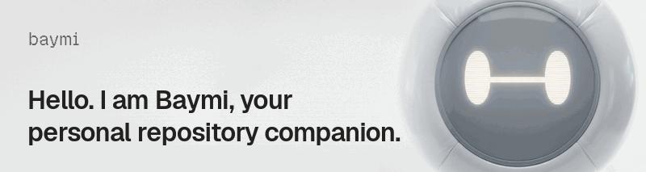

<p align="center">
  <picture>
    <source media="(prefers-reduced-motion: reduce)" srcset="./brand/banner.png">
    
  </picture>
</p>

# Baymi

[](https://github.com/PunGrumpy/baymi/actions/workflows/ci.yml) [](https://eve.dev) [](./LICENSE)

Baymi reviews every pull request opened on the repositories its GitHub App is installed on, for security only. It reads the diff and the code around it, then submits one GitHub review, and reviews again on every push. Each finding is an inline comment on the line that causes it, with the reasoning folded away and a suggestion you can commit in one click when the fix is small enough. The summary is one comment on the pull request, edited on every push rather than posted again. When it finds nothing, the summary says so in two sentences.

```text
src/routes/admin.ts:12                                          Unresolved

  High · any caller can change any user's role

  ▸ Why the code allows it, and what closes it

  ┌ Suggested change ──────────────────────────────── Commit suggestion ┐
  │ - router.post('/admin/users/:id/role', async (req, res) => {        │
  │ + router.post('/admin/users/:id/role', requireAdmin, async (req, res) => {
  └─────────────────────────────────────────────────────────────────────┘
  Unverified suggestion. I do not run code, so read it before committing.

baymiai reviewed
  Security review: 1 finding (1 high).
```

Baymi's reviews never change your code and never run it. The reviewing agent has no shell, no file writes, and no outbound fetch. The one exception is the chase: when your pull request's own code fails its checks, a separate subagent reproduces the failure in its own sandbox, fixes it, and pushes the fix to that pull request's branch. It never merges; that stays your click.

Baymi is also the engineering lead for the person who installed it. It follows their open pull requests toward merge, works each in a fixed order (conflicts, then review threads, then CI), tells a flaky check from a stale base from a bug in the diff, and speaks up only for what needs them: a green pull request waiting on their merge, a question nobody answered, a conflict only the author can resolve, a blocker it cannot clear. Merging stays their click. The standing orders are in `agent/instructions/lead.ts` and the playbook is the `engineering-lead` skill. Today it does this when you ask, in Slack or on a mention, and it posts a digest to Slack at 08:00 in Bangkok every weekday. The review turn never carries these orders. When a check on one of their pull requests goes red, it classifies the failure, reruns a flake once, hands a failure in the diff's own code to the chase, and tells them on Slack only if the pull request is still blocked on them; that needs the GitHub App subscribed to `check_run` and `workflow_run`.

## What it does

- **Reviews every pull request**: opened on an installed repository, for security only. Drafts wait until they are marked ready; bots are skipped. Each push gets a follow-up that updates the same summary comment, says which earlier findings the push fixed, and adds inline comments only for new ones. The head commit is checked out, so it reads the callers, the middleware, and the config around the change, not only the hunk. Findings land as inline review comments you can resolve one by one.
- **Answers an @mention**: from an owner, member, or collaborator on any issue or pull request. Ask about a finding, ask it to check one file, or ask for a second look after a fix, and it answers each earlier finding in its own thread: fixed, still open, or withdrawn.
- **Answers in Slack**: what it found on a pull request, what is open, which repositories it watches. Tell it how you want findings reported or what counts as noise, and it saves that to memory.
- **Takes a red pull request to green**: when a check on your pull request fails because of the diff's own code, or when you ask, the chase subagent reproduces the failure with the project's own scripts in its own sandbox (lifecycle scripts off), makes the smallest fix, runs every check again, and pushes atomic commits to the branch, or opens a pull request against it when it may not push there. Two attempts at most, three chases a day and one per head, per runtime (the counters are in memory); if it cannot fix it, you get one Slack line saying why. It needs `ANTHROPIC_API_KEY` in the deployment's environment, since it runs on Claude Sonnet 5.5 directly. `docs/chase.md` has the details.
- **Posts to Slack on its own in two cases**: a critical or high finding, and a review that could not finish. One card each, with a button to the pull request, so a missing review is not mistaken for a clean one.
- **Posts a digest every weekday morning**: at 08:00 in Bangkok (`0 1 * * 1-5`, since Vercel evaluates cron in UTC), one Thai message to `SLACK_NOTIFY_CHANNEL`. It starts with the pull requests that need you, as links with one sentence each (green and waiting on your merge, a human question nobody answered, changes a reviewer requested on your own pull request, a conflict only the author can fix), then the blocked ones and why (failing CI as a flake, a failure the base branch has too, one other open pull requests share, or the diff's own code; checks it could not read, listed as unknown; bot findings nobody looked at), and ends with a count of the healthy rest, with a line saying so when the list is cut short. It covers the open, non-draft pull requests updated in the last 30 days in the repositories the App is installed on, reads GitHub and writes nothing there, and uses no model. It looks at the channel's history for today's key (the Bangkok date) before posting so a redelivered cron fire posts nothing twice, and posts nothing if it cannot tell, which means the bot must be a member of the channel (a member ID as the target needs nothing). A Vercel Hobby plan runs a cron once a day and up to an hour late; `bun run dev` never fires it, so trigger it with `curl -X POST http://localhost:2000/eve/v1/dev/schedules/digest`.

```text
🟠 acme/widgets #12 has a high finding
│ The new upload endpoint writes to a caller-chosen path.
│ 72eadbc | acme/widgets | via Baymi security review | Today at 10:35 AM
│ [ View pull request ]  [ Files changed ]
```

Where you install the GitHub App decides what Baymi watches. There is no repository list to configure.

## Surfaces

| Surface | Route | What triggers it |
| --- | --- | --- |
| GitHub | `/eve/v1/github` | A pull request opened, marked ready for review, or pushed to; `@baymiai` from an owner, member, or collaborator |
| Slack | `/eve/v1/slack` | A direct message, an @mention, or a follow-up in a thread it is already working in |
| HTTP | `/eve/v1/session` | The direct API, which `eve dev` and the evals use |

## Requirements

- [Bun](https://bun.sh)
- A Vercel account with the [Vercel CLI](https://vercel.com/docs/cli) authenticated (`vercel login`)
- An [Anthropic API key](https://console.anthropic.com/settings/keys) as `ANTHROPIC_API_KEY`. The root agent calls Claude Opus 5.5 on Anthropic directly, with no gateway, set in `agent/lib/model.ts`, and the chase subagent calls Claude Sonnet 5.5 the same way

## Setup

### 1. Install and link

```bash
bun install
vercel link
vercel env pull
```

### 2. Fill in the environment

Copy `.env.example` to `.env` and set every value. `agent/lib/env.ts` declares and validates all of them. No required variable has a fallback, so a missing value fails discovery with one report that names every problem.

### 3. Provision the connectors

Both channels read their credentials from a [Vercel Connect](https://vercel.com/docs/connect) connector, so this repository holds no app private key or bot token. The one secret it holds is the GitHub webhook secret.

**GitHub**: create the connector, then point the App's own webhook at the deployment instead of at Connect's forwarder, which is metered per delivery:

```bash
vercel connect create github
```

In the GitHub App's settings, set the webhook URL to `https://your_deployment.vercel.app/eve/v1/github`, generate a secret into `GITHUB_WEBHOOK_SECRET`, and subscribe to `pull_request`, `issue_comment`, and `pull_request_review_comment`. Permissions: Contents read and write, Metadata read, Issues read and write, Pull requests read and write. Reviews need only Contents read; the chase pushes a fix to a pull request's branch, or a `baymi/chase/` branch, with write, so protect each default branch with a rule that requires a pull request.

**Slack**: create the connector with triggers and register eve's route:

```bash
vercel connect create slack --triggers
vercel connect detach slack/your_connector_name --yes
vercel connect attach slack/your_connector_name --triggers --trigger-path /eve/v1/slack --yes
```

Bot scopes: `chat:write`, plus `im:write` if the check-in target is a member. For thread follow-ups without a mention, add `message.channels` under trigger event types and `channels:history` under bot scopes (`message.groups` and `groups:history` for private channels).

### 4. Provision memory

```bash
bun x eve integration setup file-memory
```

This creates a private Vercel Blob store for the memory document and connects it to the project. Under `eve dev`, memory is held in process and needs no setup.

### 5. Deploy, then install the apps

```bash
bun x eve deploy
```

Install the GitHub App on the repositories Baymi should watch, and the Slack app in your workspace. To receive check-ins, put a channel ID or your member ID in `SLACK_NOTIFY_CHANNEL`.

## Local development

```bash
bun run dev
```

The webhook surfaces need a deployment to receive events, so drive the agent through the terminal UI. Paste a diff and ask for a review; the same instructions and skill apply. eve does not load `.env` during discovery, so pass it explicitly when you run the CLI outside the dev UI:

```bash
env $(grep -v '^#' .env | grep -v '^$' | xargs) bun x eve info
```

The root's model needs only `ANTHROPIC_API_KEY`. `vercel env pull` writes the `VERCEL_OIDC_TOKEN` that the remediation subagent's gateway model, Vercel Blob and Vercel Sandbox need into `.env.local`. It expires, so pull again when one of them answers 401.

`bun run validate` typechecks and runs discovery together. `bun run test` covers the logic under `agent/lib/`. `bun run eval` scores the agent against the live model and spends Anthropic credit: every eval is tagged `fast`, and `--tag lead` runs only the ones that pin the engineering lead (quiet when healthy, never merges, Thai to the owner, a memory round trip). `bun scripts/review-bench.ts <model>...` counts how many planted flaws a model finds, which is how to compare one before changing `agent/lib/model.ts`.

## Where the code lives

- [ARCHITECTURE.md →](./ARCHITECTURE.md) every capability under `agent/`, and why the agent is read-only
- [Capability placement →](./docs/capability-placement.md) where a new tool, skill, or memory belongs
- [Notes →](./docs/notes.md) runtime behaviour that cost time to discover
- [Brand assets →](./brand/README.md) the logo, the banner, and the generator behind it

Built on the [eve](https://eve.dev) agent framework. The structure follows [Evi in `evloghq/evlog`](https://github.com/evloghq/evlog/tree/main/apps/evi). The name comes from Baymax, the healthcare companion in Big Hero 6.

[MIT-licensed](./LICENSE)
